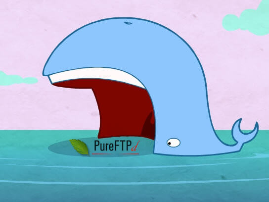

<p align="center"><a href="https://github.com/crazy-max/docker-pure-ftpd" target="_blank"></a></p>

<p align="center">
  <a href="https://hub.docker.com/r/crazymax/pure-ftpd/tags?page=1&ordering=last_updated"></a>
  <a href="https://github.com/crazy-max/docker-pure-ftpd/actions?workflow=build"></a>
  <a href="https://hub.docker.com/r/crazymax/pure-ftpd/"></a>
  <a href="https://hub.docker.com/r/crazymax/pure-ftpd/"></a>
  <br /><a href="https://github.com/sponsors/crazy-max"></a>
  <a href="https://www.paypal.me/crazyws"></a>
</p>

## About

[Pure-FTPd](https://github.com/jedisct1/pure-ftpd) Docker image based on Alpine
Linux, with PureDB, MySQL, PostgreSQL and LDAP authentication support.

> [!TIP]
> Want to be notified of new releases? Check out 🔔 [Diun (Docker Image Update Notifier)](https://github.com/crazy-max/diun)
> project!

___

* [Features](#features)
* [Build locally](#build-locally)
* [Image](#image)
* [Environment variables](#environment-variables)
* [Volumes](#volumes)
* [Ports](#ports)
* [Usage](#usage)
  * [Docker Compose](#docker-compose)
  * [Command line](#command-line)
* [Upgrade](#upgrade)
* [Notes](#notes)
  * [Flags](#flags)
  * [Secure mode](#secure-mode)
  * [PureDB authentication method](#puredb-authentication-method)
  * [Persist FTP user home](#persist-ftp-user-home)
  * [MySQL authentication method](#mysql-authentication-method)
  * [PostgreSQL authentication method](#postgresql-authentication-method)
  * [TLS connection](#tls-connection)
  * [Logs](#logs)
* [Contributing](#contributing)
* [License](#license)

## Features

* Multi-platform image
* [s6-overlay](https://github.com/just-containers/s6-overlay/) as process supervisor
* [PureDB](#puredb-authentication-method), [MySQL](#mysql-authentication-method), [PostgreSQL](#postgresql-authentication-method) and LDAP support
* [Pure-FTPd](https://github.com/jedisct1/pure-ftpd) compiled from source
* Argon2 and scrypt password hashing through [libsodium](https://libsodium.org/)
* Logs sent to `stdout` through [socklog-overlay](https://github.com/just-containers/socklog-overlay/)
* Run a script after each upload with `pure-uploadscript`
* Automatic public IP detection for passive connections

## Build locally

```shell
git clone https://github.com/crazy-max/docker-pure-ftpd.git
cd docker-pure-ftpd

# Build image and output to docker (default)
docker buildx bake

# Build multi-platform image
docker buildx bake image-all
```

## Image

| Registry                                                                                             | Image                         |
|------------------------------------------------------------------------------------------------------|-------------------------------|
| [Docker Hub](https://hub.docker.com/r/crazymax/pure-ftpd/)                                           | `crazymax/pure-ftpd`          |
| [GitHub Container Registry](https://github.com/users/crazy-max/packages/container/package/pure-ftpd) | `ghcr.io/crazy-max/pure-ftpd` |

The image supports the following platforms:

```
$ docker buildx imagetools inspect crazymax/pure-ftpd --format "{{json .Manifest}}" | \
  jq -r '.manifests[] | select(.platform.os != null and .platform.os != "unknown") | .platform | "\(.os)/\(.architecture)\(if .variant then "/" + .variant else "" end)"'

linux/amd64
linux/arm/v6
linux/arm/v7
linux/arm64
linux/ppc64le
```

## Environment variables

* `TZ`: Timezone assigned to the container (default `UTC`)
* `AUTH_METHOD`: Authentication method: `puredb`, `mysql`, `pgsql` or `ldap` (default `puredb`)
* `SECURE_MODE`: Enable [secure mode](#secure-mode) (default `true`)
* `PASSIVE_IP`: IP address or hostname advertised for passive connections. Defaults to the public IP returned by `dig +short myip.opendns.com @resolver1.opendns.com`.
* `PASSIVE_PORT_RANGE`: Port range for passive connections (default `30000:30009`)
* `DB_TIMEOUT`: Database startup timeout in seconds, used only with `mysql` and `pgsql` authentication (default `45`)
* `UPLOADSCRIPT`: Absolute path to a program or script to run after an upload (for example `/data/uploadscript.sh`)

> [!IMPORTANT]
> Set `UPLOADSCRIPT` to the absolute path of a program or script inside the
> container. The image adds `--uploadscript` automatically; do not add it to
> `/data/pureftpd.flags` yourself.

## Volumes

* `/data`: Configuration files, TLS certificates and the PureDB user database

> [!IMPORTANT]
> Mount FTP users' home directories separately to persist uploaded files.
> Mounting `/data` alone does not persist files stored under `/home`.

## Ports

* `2100`: FTP port
* `30000-30009`: PASV port range

> [!NOTE]
> If you change `PASSIVE_PORT_RANGE`, publish the same range on the host and
> allow it through your firewall. Set `PASSIVE_IP` to an address or hostname
> reachable by your clients if automatic public IP detection does not suit
> your network.

## Usage

### Docker Compose

Docker Compose is the recommended way to run this image. Save the
[Compose template](examples/puredb/compose.yml) as `compose.yml`, then run:

```bash
docker compose up -d
docker compose logs -f
```

### Command line

You can also use the following minimal command:

```bash
docker run -d --name pure-ftpd \
  -p 2100:2100 \
  -p 30000-30009:30000-30009 \
  -e "TZ=Europe/Paris" \
  -v "$(pwd)/data:/data" \
  crazymax/pure-ftpd
```

## Upgrade

Pull the updated image and recreate the container:

```bash
docker compose pull
docker compose up -d
```

## Notes

### Flags

This image configures Pure-FTPd with command-line flags and does not read
`/etc/pure-ftpd.conf`. The [startup script](rootfs/etc/cont-init.d/01-config.sh)
sets the required flags. Add other options to `/data/pureftpd.flags`, one per
line:

```
-d
-d
--maxclientsperip 5
--minuid 100
--limitrecursion 10000:3
```

Restart the container after editing this file. See the upstream
[Pure-FTPd documentation](https://github.com/jedisct1/pure-ftpd/blob/master/README)
for available options.

### Secure mode

`SECURE_MODE=true` enables additional restrictions in the
[startup script](rootfs/etc/cont-init.d/01-config.sh), including a limit of
five clients in total and per IP address, confinement to users' home
directories, blocked file renaming, and blocked reads and writes of dotfiles.
Set it to `false` to disable this group of flags.

> [!IMPORTANT]
> Secure mode does not enable encryption. Configure [TLS](#tls-connection)
> separately to protect credentials and file transfers.

### PureDB authentication method

With [PureDB authentication](examples/puredb), the container creates
`/data/pureftpd.passwd` if it does not exist and rebuilds `/data/pureftpd.pdb`
from that password file at startup.

On the first start, the database is empty. Create a user with:

```
$ docker compose exec pureftpd pure-pw useradd foo -u 1003 -g 1005 -d /home/foo -m
Password:
Enter it again:
$ docker compose exec pureftpd pure-pw list
foo                 /home/foo/./
```

The command prompts for a password and creates the virtual FTP user `foo`
with UID `1003`, GID `1005`, and home directory `/home/foo`. The `-d` option
restricts the user to that directory. Choose IDs that match the ownership
of your mounted files.

> [!TIP]
> Use `-m` when adding, modifying or deleting users to update the PureDB
> database immediately. Otherwise, apply changes without restarting with:
>
> ```bash
> docker compose exec pureftpd pure-pw mkdb
> ```

See the upstream [virtual user documentation](https://github.com/jedisct1/pure-ftpd/blob/master/README.Virtual-Users)
for password changes, quotas and other account settings.

### Persist FTP user home

Persist the user's home directory with a volume or bind mount. For the
previous example, add `./foo:/home/foo` to the Compose configuration:

```yaml
services:
  pureftpd:
    image: crazymax/pure-ftpd
    container_name: pureftpd
    ports:
      - "2100:2100"
      - "30000-30009:30000-30009"
    volumes:
      - "./data:/data"
      - "./foo:/home/foo"
    environment:
      - "TZ=Europe/Paris"
      - "AUTH_METHOD=puredb"
    restart: always
```

### MySQL authentication method

The [MariaDB example](examples/mariadb) demonstrates MySQL authentication.
Set `AUTH_METHOD=mysql` and provide a [configuration file](examples/mariadb/data/pureftpd-mysql.conf)
at `/data/pureftpd-mysql.conf` before starting the FTP container.

The example initializes the database and [users table](examples/mariadb/users.sql)
when the database container starts with an empty data directory.

Create and inspect a user in the example MariaDB database:

```
$ docker compose exec db mysql -u pureftpd -p'asupersecretpassword' -e "INSERT INTO users (User,Password,Uid,Gid,Dir) VALUES ('foo',ENCRYPT('test'),'1003','1005','/home/foo');" pureftpd
$ docker compose exec db mysql -u pureftpd -p'asupersecretpassword' -e "SELECT * FROM users;" pureftpd
+------+---------------+------+------+-----------+
| User | Password      | Uid  | Gid  | Dir       |
+------+---------------+------+------+-----------+
| foo  | Oo4cJdd1HNVA6 | 1003 | 1005 | /home/foo |
+------+---------------+------+------+-----------+
```

> [!NOTE]
> This example creates `foo` with UID `1003`, GID `1005`, home directory
> `/home/foo`, and password `test`. It uses MariaDB's `ENCRYPT()` function
> with `MYSQLCrypt crypt`, as configured in the example.

See the upstream [MySQL/MariaDB documentation](https://github.com/jedisct1/pure-ftpd/blob/master/README.MySQL)
for supported password hashes and per-user settings.

### PostgreSQL authentication method

The [PostgreSQL example](examples/postgresql) demonstrates PostgreSQL
authentication. Set `AUTH_METHOD=pgsql` and provide a [configuration file](examples/postgresql/data/pureftpd-pgsql.conf)
at `/data/pureftpd-pgsql.conf` before starting the FTP container.

The example initializes the database and [users table](examples/postgresql/users.sql)
when the database container starts with an empty data directory.

Run the following SQL in the `pureftpd` database to create a user with a
hashed password and explicit UID and GID:

```sql
CREATE EXTENSION IF NOT EXISTS pgcrypto;
INSERT INTO "users" ("User", "Password", "Uid", "Gid", "Dir")
VALUES ('foo', crypt('mypassword', gen_salt('bf')), 1003, 1005, '/home/foo');
```

See the upstream [PostgreSQL documentation](https://github.com/jedisct1/pure-ftpd/blob/master/README.PGSQL)
for supported password hashes and per-user settings.

### TLS connection

Place the certificate and its private key in `/data/pureftpd.pem`. If they
are in separate PEM files, concatenate them into this file.

Add a TLS mode to `/data/pureftpd.flags`. For example, to require encryption
for both login and file transfers:

```text
--tls=3
```

The upstream [TLS documentation](https://github.com/jedisct1/pure-ftpd/blob/master/README.TLS)
defines these modes:

| Mode | Behavior                                                 |
|------|----------------------------------------------------------|
| `0`  | Disable TLS (default).                                   |
| `1`  | Allow both unencrypted and TLS connections.              |
| `2`  | Require TLS for the control connection, including login. |
| `3`  | Require TLS for both control and data connections.       |

> [!IMPORTANT]
> The `--tls` flag requires a numeric value. A bare `--tls` can cause a
> startup error. Restart the container after changing the flags or certificate.

For testing, generate a self-signed certificate with the following commands.
Replace `ftp.example.com` with the hostname your clients use:

```bash
mkdir -p data
docker run --rm -it --entrypoint openssl -v "$(pwd)/data:/data" crazymax/pure-ftpd dhparam -out /data/pureftpd-dhparams.pem 2048
docker run --rm -it --entrypoint openssl -v "$(pwd)/data:/data" crazymax/pure-ftpd req -x509 -nodes -newkey rsa:2048 -sha256 -days 365 -keyout /data/pureftpd.pem -out /data/pureftpd.pem -subj "/CN=ftp.example.com" -addext "subjectAltName=DNS:ftp.example.com"
```

Configure your FTP client to use **explicit FTP over TLS (FTPS)** on port
`2100` (or the host port you published). The client connects to the FTP port
and requests TLS with `AUTH TLS`. With mode `3`, enable encryption for data
connections in the client as well.

> [!NOTE]
> A self-signed certificate is not trusted automatically. Verify it before
> trusting it in your FTP client, or use a certificate issued by a CA that
> your client trusts.

### Logs

Logs are sent to `stdout` through `socklog-overlay`. Follow them with:

```bash
docker compose logs -f pureftpd
```

For more detail, add `-d` twice on separate lines in `/data/pureftpd.flags`
and restart the container.

## Contributing

Want to contribute? Awesome! The most basic way to show your support is to star
the project, or to raise issues. You can also support this project by [**becoming a sponsor on GitHub**](https://github.com/sponsors/crazy-max)
or by making a [PayPal donation](https://www.paypal.me/crazyws) to ensure this
journey continues indefinitely!

Thanks again for your support, it is much appreciated! :pray:

## License

MIT. See `LICENSE` for more details.
